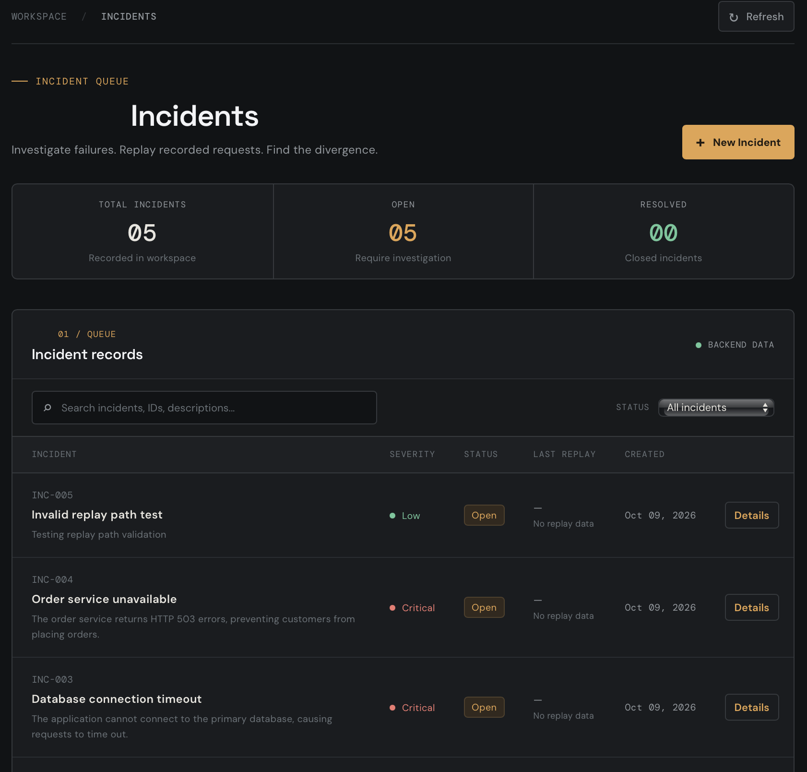
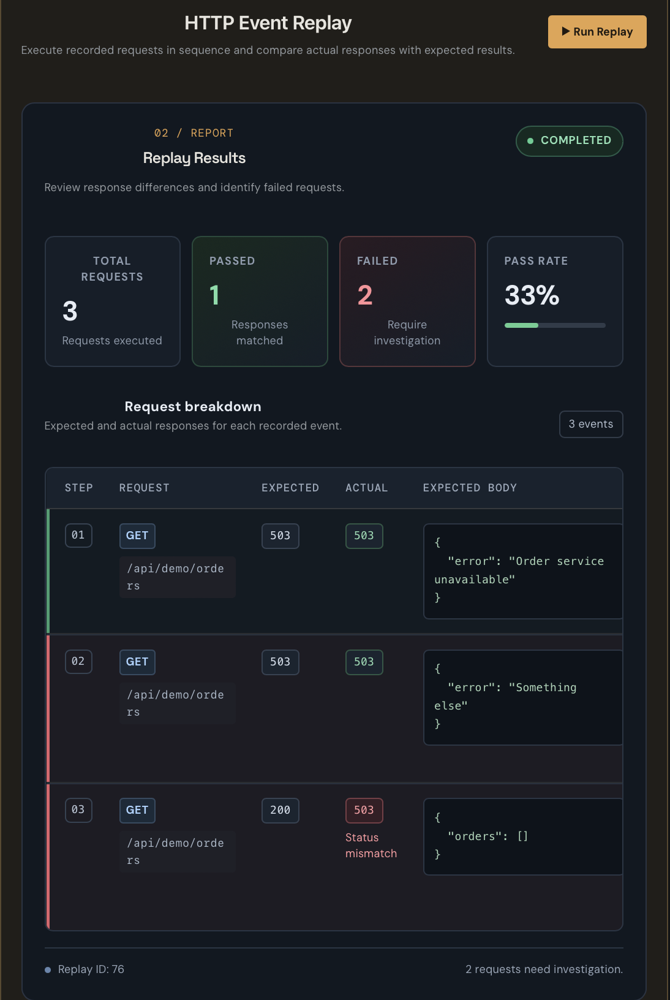

# RETRACE — Incident Replay & Debugging Platform

RETRACE is a full-stack incident management and HTTP replay platform built to help developers investigate API failures, reproduce unexpected behavior, and identify differences between expected and actual responses.

The platform allows developers to organize incidents, record HTTP request sequences, execute replays, and inspect detailed request-level results through a centralized dashboard.

---

## Features

- **Incident Management:** Create and organize incidents with descriptions and severity levels.
- **Incident Dashboard:** View total, open, and resolved incidents.
- **Search and Filtering:** Search incidents by title, description, severity, status, or ID and filter by status.
- **HTTP Event Recording:** Associate ordered HTTP requests with incidents, including methods, paths, expected status codes, and JSON request and response bodies.
- **HTTP Replay Execution:** Execute recorded HTTP events through the backend replay workflow.
- **Replay Reports:** Compare expected and actual HTTP status codes and response bodies, with per-request PASS/FAIL results, execution durations, and error details.
- **Input Validation:** Validate incident details, sequence numbers, HTTP status codes, request paths, and JSON bodies.
- **API Error Handling:** Display API errors and provide retry actions when loading incidents or events fails.

---

## Tech Stack

### Frontend

- React
- TypeScript
- Vite
- CSS

### Backend

- Node.js
- Express
- TypeScript
- PostgreSQL

### Testing and Tooling

- Jest
- npm

---

## Application Screenshots

### Incident Dashboard



### HTTP Replay Report



---

## How It Works

1. Create an incident describing an API failure.
2. Open the incident details page.
3. Record HTTP events in the order they should execute.
4. Specify the expected HTTP status code and, optionally, an expected JSON response body for each event.
5. Run the replay to execute the recorded request sequence.
6. Inspect the replay report to identify passing requests, status-code mismatches, response-body differences, and execution errors.

**Important:** At least one HTTP event must be recorded before a replay can be started.

---

## Example Use Case

Imagine an order service that returns unexpected HTTP `503 Service Unavailable` responses.

A developer creates an incident, records a sequence of HTTP requests, and defines the expected status codes and response bodies for each request.

After executing the replay, the report shows which requests passed, which failed, and where the actual behavior diverged from expectations.

This makes it easier to investigate failures without relying solely on manually reproducing requests.

---

## Project Structure

```text
RETRACE/
├── frontend/
│   └── src/
│       ├── services/
│       │   └── api.ts
│       ├── App.tsx
│       ├── App.css
│       └── index.css
├── backend/
│   ├── src/
│   │   ├── controllers/
│   │   ├── db/
│   │   ├── repositories/
│   │   ├── routes/
│   │   ├── services/
│   │   ├── app.ts
│   │   └── server.ts
│   ├── test/
│   ├── package.json
│   └── tsconfig.json
├── docs/
│   └── screenshots/
├── README.md
└── .gitignore
````

## Getting Started

### Prerequisites

Make sure you have the following installed:

- Node.js and npm
- PostgreSQL

### 1. Clone the Repository

bash
```
git clone YOUR_GITHUB_REPOSITORY_URL
cd RETRACE
```

Replace `YOUR_GITHUB_REPOSITORY_URL` with your repository's URL.

### 2. Configure the Backend

Create a `backend/.env` file:

env
```
DATABASE_URL=postgresql://localhost:5432/incident_replay
PORT=5001
```

Update the connection string if your PostgreSQL setup requires a username, password, or different host.

### 3. Create and Initialize the Database

Create the database if it does not already exist:

sql
```
CREATE DATABASE incident_replay;
```

From the project root, initialize the schema:

bash
```
psql -d incident_replay -f backend/src/db/schema.sql
```

Ensure PostgreSQL is running before starting the backend.

### 4. Install and Start the Backend

Open a terminal and navigate to the backend directory:

bash
```
cd backend
npm install
npm run dev
```

Use the development script defined in `backend/package.json`. If no `dev` script exists, use the appropriate script listed there.

### 5. Configure and Start the Frontend

Open a second terminal and navigate to the frontend directory:

bash
```
cd frontend
npm install
```

Create a `frontend/.env` file:

env
```
VITE_API_BASE_URL=http://localhost:5001/api
```

Start the frontend:

bash
```
npm run dev
```

Open the local URL printed in the terminal by Vite.

## Testing

Run the backend test suite from the backend directory:

bash
```
cd backend
npm test
```

Check `backend/package.json` for the available test scripts.

## Future Improvements

- Replay history and comparisons between previous runs.
- Visual JSON response diffs.
- Incident status updates and resolution workflows.
- Pagination and advanced filtering.
- Automated frontend and API integration tests.
- Authentication and multi-user workspaces.
- Cloud deployment and hosted database support.

## What I Learned

- Building a full-stack application with React and TypeScript.
- Designing REST API integrations and handling asynchronous requests.
- Modeling incident, event, and replay data in PostgreSQL.
- Validating structured request data and displaying actionable errors.
- Comparing expected and actual API behavior to support debugging workflows.

## Built With

- React
- TypeScript
- Vite
- Node.js
- Express
- PostgreSQL
- Jest

RETRACE — Making API failures easier to reproduce, investigate, and debug.