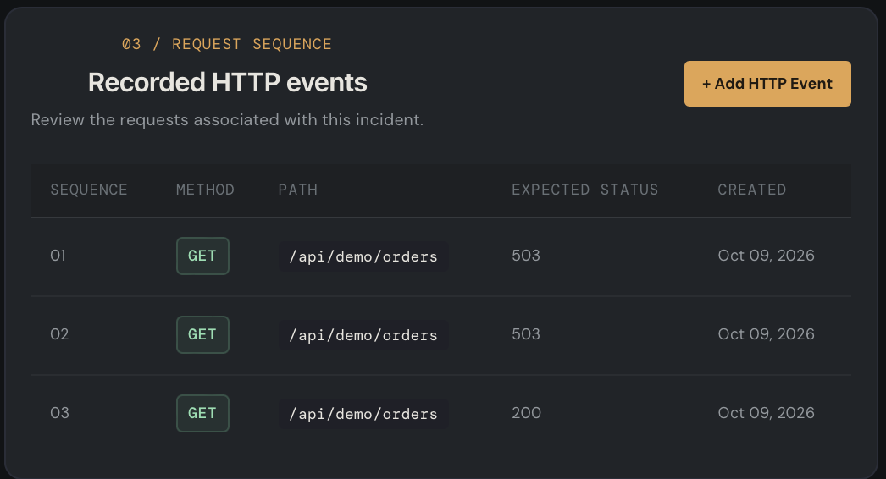
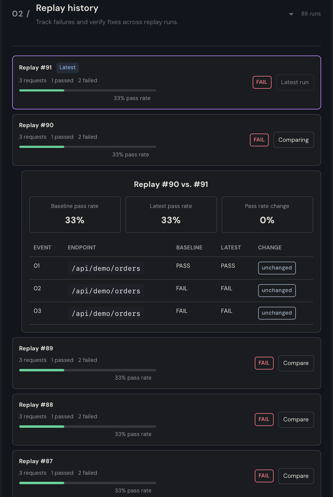

# RETRACE — Incident Replay & Debugging Platform

RETRACE is a full-stack incident management and HTTP replay platform designed to help developers investigate API failures, reproduce unexpected behavior, and identify differences between expected and actual responses.

The platform allows developers to organize incidents, record ordered HTTP request sequences, execute replays, inspect response differences, and compare results across replay runs through a centralized debugging dashboard.

---

## Features

- **Incident Management:** Create and organize incidents with descriptions and severity levels.
- **Incident Dashboard:** View incident statistics, including total, open, and resolved incidents.
- **Search and Filtering:** Search incidents by title, description, severity, status, or ID and filter by status.
- **HTTP Event Recording:** Associate ordered HTTP requests with incidents, including methods, paths, expected status codes, headers, and JSON request and response bodies.
- **HTTP Replay Execution:** Execute recorded HTTP events sequentially through the backend replay workflow.
- **Response Diff Viewer:** Compare expected and actual HTTP responses to identify status-code mismatches and differences in JSON response bodies.
- **Request Timeline:** Inspect recorded HTTP events in sequence to understand the order of requests associated with an incident.
- **Replay Reports:** View per-request PASS/FAIL results, execution durations, actual responses, and error details.
- **Replay History:** Browse previous replay runs and review their request counts, pass rates, and failure summaries.
- **Replay Comparison:** Compare an earlier replay against a newer run to identify improved requests, regressions, unchanged results, and newly recorded events.
- **Input Validation:** Validate incident details, sequence numbers, HTTP status codes, request paths, and JSON bodies.
- **API Error Handling:** Display actionable API errors and provide retry options when supported.

---

## Tech Stack

### Frontend

- React
- TypeScript
- Vite
- CSS

### Backend

- Node.js
- Express
- TypeScript
- PostgreSQL

### Testing and Tooling

- Jest
- npm

---

## Application Screenshots

The following screenshots demonstrate the main incident investigation and replay workflows.

### 1. Incident Dashboard

View incidents, search and filter records, and identify issues that need investigation.


### 2. HTTP Replay Report and Response Diff Viewer

Inspect replay results, compare expected and actual responses, and identify failed requests.


### 3. Recorded HTTP Request Timeline

Review the ordered HTTP events associated with an incident, including request methods, paths, and expected status codes.



### 4. Replay History and Comparison

Browse previous replay runs, compare pass rates, and inspect request-level changes between a baseline replay and a newer run.



**Note:** Ensure the screenshot files exist at these paths in your repository. Update the filenames if necessary.

---

## How It Works

1. **Create an incident:** Describe the API failure and assign a severity level.
2. **Record HTTP events:** Add the requests associated with the incident in their intended execution order.
3. **Define expected behavior:** Specify the expected HTTP status code and, optionally, the expected JSON response body for each event.
4. **Execute a replay:** Run the recorded requests sequentially against the configured demo API.
5. **Inspect response differences:** Use the replay report and response diff viewer to identify mismatches between expected and actual behavior.
6. **Review the request timeline:** Examine the recorded request sequence to understand the order of operations.
7. **Track replay history:** Run the replay again after investigating or fixing an issue.
8. **Compare replay runs:** Compare previous and newer runs to see whether failures have improved, persisted, or regressed.

**Important:** At least one HTTP event must be recorded before a replay can be started.

---

## Development Progression

RETRACE was developed incrementally, with each feature building on the previous debugging workflow.

- **Response Diff Viewer:** Built the initial request-level debugging experience to compare expected and actual HTTP responses and highlight failures.
- **Request Timeline:** Added an ordered view of recorded HTTP events to make request sequences easier to inspect and understand.
- **Replay History and Comparison:** Added historical replay tracking and the ability to compare runs, monitor pass-rate changes, and identify improvements or regressions.

This progression evolved RETRACE from a tool for inspecting a single replay into a more complete workflow for investigating incidents and verifying fixes across repeated executions.

---

## Example Use Case

Imagine an order service that returns unexpected HTTP `503 Service Unavailable` responses.

A developer creates an incident, records several HTTP requests, and defines the expected status codes and response bodies.

After executing a replay, the response diff viewer identifies requests that do not match expectations. The request timeline helps the developer inspect the execution sequence.

Once the underlying issue has been investigated and a fix has been applied, the developer runs the replay again and compares the latest results with a previous run. Replay history makes it easier to determine whether the fix improved the results or introduced regressions.

This workflow supports repeatable API debugging without relying solely on manually reproducing requests.

---

## Project Structure

```text
RETRACE/
├── frontend/
│   └── src/
│       ├── components/
│       │   ├── ReplayHistory.tsx
│       │   └── ReplayHistory.css
│       ├── services/
│       │   └── api.ts
│       ├── App.tsx
│       ├── App.css
│       └── index.css
├── backend/
│   ├── src/
│   │   ├── controllers/
│   │   │   └── replayController.ts
│   │   ├── db/
│   │   ├── repositories/
│   │   ├── routes/
│   │   │   └── replayRoutes.ts
│   │   ├── services/
│   │   │   └── replayService.ts
│   │   ├── app.ts
│   │   └── server.ts
│   ├── test/
│   ├── package.json
│   └── tsconfig.json
├── docs/
│   └── screenshots/
│       ├── incident-dashboard.png
│       ├── replay-report.png
│       ├── request-timeline.png
│       └── replay-history.png
├── README.md
└── .gitignore
````

Note: This is an illustrative project structure. Adjust filenames and folders to match your actual repository.

## Getting Started

### Prerequisites

Make sure you have the following installed:

- Node.js and npm
- PostgreSQL
- Git

### 1. Clone the Repository

bash
```
git clone YOUR_GITHUB_REPOSITORY_URL
cd RETRACE
```

Replace `YOUR_GITHUB_REPOSITORY_URL` with your repository's URL.

### 2. Configure the Backend

Create a `backend/.env` file:

env
```
DATABASE_URL=postgresql://localhost:5432/incident_replay
PORT=5001
```

Update the connection string if your PostgreSQL setup requires a username, password, or different host.

### 3. Create and Initialize the Database

Create the database if it does not already exist:

sql
```
CREATE DATABASE incident_replay;
```

From the project root, initialize the schema:

bash
```
psql -d incident_replay -f backend/src/db/schema.sql
```

Ensure PostgreSQL is running before starting the backend.

### 4. Install and Start the Backend

Open a terminal and navigate to the backend directory:

bash
```
cd backend
npm install
npm run dev
```

Use the development script defined in `backend/package.json`. If no `dev` script exists, use the appropriate script listed there.

### 5. Configure and Start the Frontend

Open a second terminal and navigate to the frontend directory:

bash
```
cd frontend
npm install
```

Create a `frontend/.env` file:

env
```
VITE_API_BASE_URL=http://localhost:5001/api
```

Start the frontend:

bash
```
npm run dev
```

Open the local URL printed in the terminal by Vite.

## Testing

Run the backend test suite from the backend directory:

bash
```
cd backend
npm test
```

Check `backend/package.json` for the available test scripts.

## Future Improvements

- Automated frontend and API integration tests.
- Pagination and advanced filtering for incidents and replay history.
- More advanced response-diff visualization and replay analytics.
- Incident status updates and resolution workflows.
- Authentication and multi-user workspaces.
- Cloud deployment and hosted database support.

## What I Learned

- Building a full-stack application using React and TypeScript.
- Designing REST API integrations and handling asynchronous requests.
- Modeling incident, event, replay-run, and replay-result data in PostgreSQL.
- Building an HTTP replay workflow to execute recorded requests sequentially.
- Comparing expected and actual API responses to support debugging.
- Designing a request timeline for inspecting recorded HTTP events.
- Tracking historical replay results and comparing runs to verify fixes and identify regressions.
- Validating structured request data and displaying actionable errors.

## Built With

- React
- TypeScript
- Vite
- Node.js
- Express
- PostgreSQL
- Jest

RETRACE — Making API failures easier to reproduce, investigate, and debug.